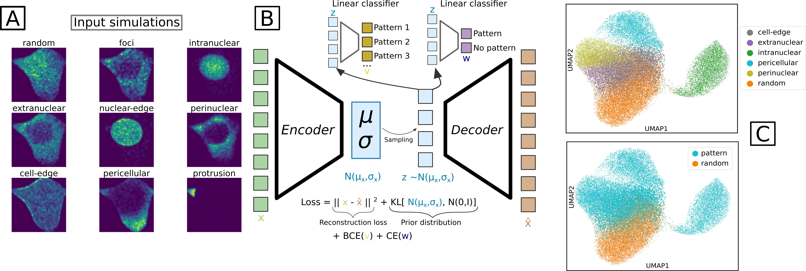

<div align="center">



# SubCellSpace

### A latent space of representing subcellular mRNA localization patterns

*Wouters et al. 2026*

[](LICENSE)
[](https://www.python.org/)
[](./yamls/)

</div>

---

## Overview

**SubCellSpace** encodes subcellular mRNA localization patterns into a compact, interpretable latent space. This repository contains all code needed to reproduce the results and figures of Wouters et al. 2026.


---

## Repository Structure

Each module ships with its own dedicated conda environment (see [`yamls/`](./yamls/)):

| Module | Description |
|--------|-------------|
| [`training_subcellspace/`](./training_subcellspace/) | Build training data and train the SubCellSpace model |
| [`make_paper_figures/`](./make_paper_figures/) | Reproduce all manuscript analyses and figures |
| [`raw_spatial_data_processing/`](./raw_spatial_data_processing/) | Process your own dataset into a SubCellSpace-ready AnnData object |


## Getting Started

### Option 1 — Conda (recommended)

Create and activate an environment for the module you want to run. For example, to reproduce the paper figures:

```bash
conda env create -n subcellspace -f ./yamls/analysis_figures.yml
conda activate subcellspace
```

Each subfolder contains a dedicated `README` with step-by-step instructions.

### Option 2 — Docker

A Docker container is also available if you prefer a fully isolated setup:

```bash
docker pull woutdavid/subcellspace_jupyter_env
docker run -it --rm -p 8888:8888 -v $(pwd):/workspace woutdavid/subcellspace_jupyter_env
```

Then open the URL printed in the terminal (e.g. `http://127.0.0.1:8888/?token=...`) in your browser.


---

## Applying SubCellSpace to your own data

Once your environment is set up, this is all you need:

1. Process your dataset using [`raw_spatial_data_processing/`](./raw_spatial_data_processing/)
2. Follow the example notebook: [`example_usage_of_SubCellSpace_on_your_data.ipynb`](./example_usage_of_SubCellSpace_on_your_data.ipynb)

No need to retrain the model or reproduce the paper figures.

---

## Citation

If you use SubCellSpace in your research, please cite:

```bibtex
@article{wouters2026subcellspace,
  title   = {SubCellSpace: A latent space of subcellular mRNA localization patterns},
  author  = {Wouters et al.},
  journal = {TBD},
  year    = {2026}
}
```

---


