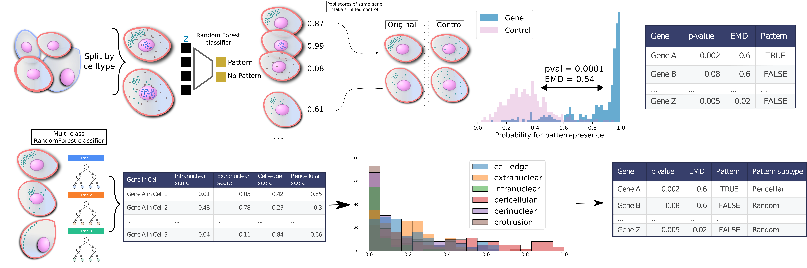

<div align="center">


# SubCellSpace

### A latent space of representing subcellular mRNA localization patterns

*Wouters et al. 2026*

[](LICENSE)
[](https://www.python.org/)
[](./yamls/)
[](https://www.biorxiv.org/content/10.64898/2026.04.28.720613v1)

</div>

---

## Overview

**SubCellSpace** encodes subcellular mRNA localization patterns into a compact, interpretable latent space. This repository contains all code needed to reproduce the results and figures of [Wouters et al. 2026](https://www.biorxiv.org/content/10.64898/2026.04.28.720613v1).



---

## Repository Structure

Each module ships with its own dedicated conda environment (see [`yamls/`](./yamls/)):

| Module | Description |
|--------|-------------|
| [`training_subcellspace/`](./training_subcellspace/) | Build training data and train the SubCellSpace model |
| [`make_paper_figures/`](./make_paper_figures/) | Reproduce all manuscript analyses and figures |
| [`benchmark/`](./benchmark/) | Benchmark of SubCellSpace against Bento, ELLA and alternative encoders (Supp. Fig. 10) |
| [`additional_analyses/`](./additional_analyses/) | Supplementary analyses: reconstruction error, recall, rotation, cell-boundary patterns, composite patterns, cell-mask input, input resolution |
| [`raw_spatial_data_processing/`](./raw_spatial_data_processing/) | Config-driven pipeline turning raw Xenium/MERFISH output into a SubCellSpace-ready AnnData object |


## Getting Started

### Option 1 — Conda (recommended)

Pick the environment for the task you want to run. The two environments most people need
have **cross-platform files that work on Linux, macOS (Intel and Apple Silicon) and Windows**:

| Task | Environment file | Env name |
|------|------------------|----------|
| Reproduce the manuscript analyses and figures | [`yamls/analysis_figures_crossplatform.yml`](./yamls/analysis_figures_crossplatform.yml) | `subcellspace_env` |
| Process your own Xenium/MERFISH data | [`yamls/pyxel_env_crossplatform.yml`](./yamls/pyxel_env_crossplatform.yml) | `pyxel_env` |

```bash
# to reproduce the paper figures
conda env create -f ./yamls/analysis_figures_crossplatform.yml
conda activate subcellspace_env

# to process your own data
conda env create -f ./yamls/pyxel_env_crossplatform.yml
conda activate pyxel_env
```

Each subfolder contains a dedicated `README` with step-by-step instructions.

> **Why there are two versions of each environment file.**
> The original `analysis_figures.yml`, `pyxel_env.yaml`, `train_cvae.yml` and
> `make_simulations.yml` were produced with `conda env export` on a Linux + CUDA machine.
> Essentially every conda package in them is pinned to a linux-64 build string (e.g.
> `python=3.9.19=h955ad1f_1`), several are Linux-only (`libgcc-ng`, `libgomp`,
> `libstdcxx-ng`, `ld_impl_linux-64`, …), and the pip sections pin CUDA wheels — including
> `triton`, which is published for Linux only and has no source distribution. They therefore
> **cannot be solved on macOS or Windows**, and are kept only as an exact record of the
> environments the paper was produced in.
>
> The `*_crossplatform.yml` files pin the same tested package versions but without build
> strings and without the platform-specific CUDA extras, so pip selects an appropriate build
> per OS. On Linux they still install the CUDA-enabled `torch`; on macOS/Windows they install
> the CPU build. The processing pipeline detects that automatically and runs segmentation on
> CPU (set `use_gpu` in the config to override). Both files were verified by resolving their
> full dependency tree against linux-x86_64, macOS-arm64, macOS-x86_64 and win-amd64.
>
> `analysis_figures_crossplatform.yml` keeps every package version from the original except
> three, each documented in the file header: Python moves 3.8 → 3.9 (3.8 is end-of-life),
> `torch`/`torchvision` come from PyPI at the same 1.13.1/0.14.1 versions, and `faiss-cpu`
> moves 1.7.0 → 1.7.4 because 1.7.0 was never released on PyPI.
>
> `train_cvae.yml` and `make_simulations.yml` have not been converted. Retraining the model
> and regenerating the simulations both assume a CUDA Linux machine anyway, and
> `make_simulations.yml` is pinned to Python 3.6 for `simfish`.

### Option 2 — Docker

A prebuilt Docker image gives a fully isolated setup and needs no conda solve at all. It
contains the **data-processing** environment (`pyxel_env`), which is what you need to turn
raw Xenium/MERFISH data into SubCellSpace embeddings. The figures and the additional analyses
use the conda environments above.

```bash
docker pull woutdavid/subcellspace:latest
docker run -it --rm -p 8888:8888 \
    -v $(pwd):/workspace \
    -v /path/to/your/data:/data \
    woutdavid/subcellspace:latest
```

Then open the URL printed in the terminal (e.g. `http://127.0.0.1:8888/?token=...`) in your
browser. The image ships the **environment only** — mount this repository at `/workspace`
(that is where the pipeline code and the trained model come from) and your data at `/data`.
Because no code is baked in, the image does not go stale when the code changes.

To run the pipeline directly instead of opening a notebook:

```bash
docker run -it --rm -v $(pwd):/workspace -v /path/to/your/data:/data \
    woutdavid/subcellspace:latest \
    python -m raw_spatial_data_processing.run raw_spatial_data_processing/configs/mine.yaml
```

Available tags on [Docker Hub](https://hub.docker.com/r/woutdavid/subcellspace):

| Tag | Download | Contents |
|-----|----------|----------|
| `latest`, `cpu` | ~1.1 GB | CPU-only PyTorch. Recommended, and the right choice on macOS/Windows. |
| `cuda` | ~2.7 GB | CUDA-enabled PyTorch, for GPU hosts. Run with `--gpus all`. |
| `analysis-cpu` | ~0.8 GB | The **analysis** environment (figures and additional analyses, see below), CPU-only PyTorch. |
| `analysis-cuda` | ~2.4 GB | The analysis environment with CUDA-enabled PyTorch. Run with `--gpus all`. |
| `1.1-cpu`, `1.1-cuda`, `1.1-analysis-cpu`, `1.1-analysis-cuda` | — | Immutable tags for the images above. |
| `1.0-cpu`, `1.0-cuda` | — | Immutable tags matching the `v1.0-paper` git tag. These bake the pipeline code in, as that is how the image was built at the time. |

> **Note.** The `1.0-*` images contain the pipeline code of the `v1.0-paper` tag baked in.
> From `1.1` onward the images ship the environment only and take the code from the repository
> you mount, so re-pull `latest` after updating this repo rather than relying on a pinned
> older tag for current code.

```bash
# on a CUDA host, for GPU-accelerated segmentation
docker run -it --rm --gpus all -p 8888:8888 \
    -v $(pwd):/workspace -v /path/to/your/data:/data woutdavid/subcellspace:cuda
```

> **Apple Silicon / ARM.** These images are built for `linux/amd64` only, so on an M-series
> Mac they run under emulation — functional, but segmentation is slow. Add
> `--platform linux/amd64` to silence the platform-mismatch warning. For native performance on
> ARM, use the conda route above instead ([`pyxel_env_crossplatform.yml`](./yamls/pyxel_env_crossplatform.yml)
> installs a native arm64 build).

To build the image yourself instead of pulling — for example after modifying the pipeline —
run from the repository root:

```bash
docker build --build-arg TORCH_VARIANT=cpu -t subcellspace:cpu .   # ~3.5 GB on disk
docker build -t subcellspace:cuda .                                # ~6.1 GB on disk
```

#### Analysis image: the figures and the additional analyses

A second image, [`yamls/Dockerfile`](./yamls/Dockerfile), contains the analysis environment
(`subcellspace_env`, from [`analysis_figures_crossplatform.yml`](./yamls/analysis_figures_crossplatform.yml))
for [`make_paper_figures/`](./make_paper_figures/) and [`additional_analyses/`](./additional_analyses/).
Like the processing image it ships the environment only. Pull it, mount the repository and
your data, and open the URL printed in the terminal:

```bash
docker pull woutdavid/subcellspace:analysis-cpu
docker run -it --rm -p 8888:8888 \
    -v $(pwd):/workspace \
    -v /path/to/your/data:/data \
    woutdavid/subcellspace:analysis-cpu
```

Use `analysis-cuda` with `--gpus all` on a GPU host. To build the image yourself instead, run
from the repository root:

```bash
docker build -f yamls/Dockerfile --build-arg TORCH_VARIANT=cpu -t subcellspace:analysis-cpu .   # ~2.4 GB on disk
docker build -f yamls/Dockerfile -t subcellspace:analysis-cuda .                                # ~5.0 GB on disk
```

The additional analyses read their inputs from `/data/additional_analysis` by default. Two
things are not covered by this image: Fig. 1B needs the simulation environment
([`make_simulations.yml`](./yamls/make_simulations.yml)), and the benchmark uses its own
environment ([`benchmark/envs/benchmark.yml`](./benchmark/envs/benchmark.yml)).


---

## Applying SubCellSpace to your own data

Once your environment is set up, this is all you need:

1. Process your dataset with [`raw_spatial_data_processing/`](./raw_spatial_data_processing/) —
   walked through step by step in
   [`tutorial_creating_adata_subcell.ipynb`](./tutorial_creating_adata_subcell.ipynb)
2. Analyse the result following
   [`example_usage_of_SubCellSpace_on_your_data.ipynb`](./example_usage_of_SubCellSpace_on_your_data.ipynb)

No need to retrain the model or reproduce the paper figures.

---

## Citation

If you use SubCellSpace in your research, please cite:

```bibtex
@article{wouters2026subcellspace,
  title   = {SubCellSpace: A latent space of subcellular mRNA localization patterns},
  author  = {Wouters et al.},
  journal = {bioRxiv},
  year    = {2026},
  doi     = {10.64898/2026.04.28.720613},
  url     = {https://www.biorxiv.org/content/10.64898/2026.04.28.720613v1}
}
```

---


